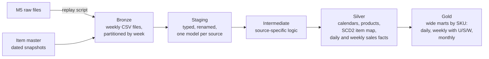

# Retail Sales Pipeline

A data pipeline that turns weekly retail sales files into tables ready for reporting and visualization. It's built with dbt and DuckDB, designed to run on AWS, and every step is tested.

The pipeline ingests weekly sales data, standardizes it into a source-independent format, keeps a full history of how retailer item numbers map to internal SKUs, and produces sales marts by SKU, by day, week, and month, including units per store per week (U/S/W), a key metric in Walmart supplier reporting.

It uses the public [M5 dataset](https://www.kaggle.com/competitions/m5-forecasting-accuracy) (five years of daily Walmart sales for 3,049 products across 10 stores), replayed as weekly file deliveries. The design is based on how real Walmart supplier data (from Walmart's Scintilla reports) arrives, so that data can be added through its own staging model without changing the rest of the pipeline.

## Architecture



| Layer | Holds | Built with |
|---|---|---|
| **Bronze** | Files exactly as delivered, partitioned by week (`wm_yr_wk=11452/`), every value kept as text | Python replay script |
| **Staging** | One view per source file: correct types, contract names | dbt views |
| **Intermediate** | Source-specific steps: joining prices, summing stores | dbt views |
| **Silver** | Source-independent tables matching the [data contract](docs/data-contracts/silver.md) | dbt tables; the daily fact is incremental |
| **Gold** | Wide, pre-joined marts for reporting | dbt tables |

## Key design decisions

Each decision is recorded as an [Architecture Decision Record](docs/adr/):

- **Weekly files with daily rows, rolled up to fiscal weeks** ([ADR 0002](docs/adr/0002-use-m5-data-replayed-weekly.md), [ADR 0004](docs/adr/0004-support-daily-and-weekly-sales-grains.md)). Real retailer data arrives weekly; daily detail is kept where a source provides it. Weekly totals are never split into days.
- **A source-independent silver contract** ([contract](docs/data-contracts/silver.md)). Each new source needs only its own staging and intermediate models; silver, gold, and reports stay unchanged.
- **Walmart's official fiscal calendar** ([ADR 0005](docs/adr/0005-use-walmart-official-fiscal-calendar.md)). Fiscal years named by the year they end, 4-5-4 fiscal months, and weeks assigned to the calendar month of their end date.
- **SCD2 item mapping rebuilt from raw snapshots.** Retailer item numbers can move to different SKUs over time. The full history is rebuilt from dated item master snapshots, with an optional effective date for changes recorded late. Each sale uses the mapping valid on its date.
- **Incremental loading by source partition** ([ADR 0006](docs/adr/0006-incremental-loading-by-day.md), [ADR 0007](docs/adr/0007-select-incremental-work-by-source-partition.md)). Runs replace whole days, so reprocessing a corrected week never creates duplicates, and read only the requested partitions' files.
- **Ratios stored with their parts.** U/S/W is stored alongside units and store counts, so it can be re-aggregated correctly: monthly U/S/W is units / store-weeks, never an average of weekly values.

## Data quality

64 dbt data tests and 10 Python tests, run on every build, plus CI on every pull request. Highlights:

| Test | Guards against |
|---|---|
| Incremental table matches a full rebuild from bronze | Bugs in incremental logic |
| Weekly totals reconcile with daily rows | Rows lost or double-counted in the rollup |
| Gold unit totals match silver | Rows lost or duplicated by the SKU mapping |
| No overlapping periods in the SCD2 item map | A sale counted under two SKUs |
| Every fiscal week has 7 days; weeks are contiguous | Sales assigned to the wrong or a missing week |
| IDs and prices kept exactly as text in bronze | Leading zeros lost (`0123` → `123`) |

Every one of these was verified to fail on deliberately broken data before being trusted.

## Results

Measured locally (WSL2), warm cache:

| Measure | Result |
|---|---|
| Units, identical in staging, silver, and every gold mart | 66,821,317 |
| Daily fact rows (3,049 items × 1,939 days) | 5,912,011 |
| Weekly fact rows (3,049 items × 277 weeks) | 844,573 |
| Full build from an empty database | about 3–5 minutes |
| Reprocessing one week, before partition pruning | 51 s |
| Reprocessing one week, after partition pruning | **4.5 s** |

## Running it locally

**Prerequisites:** Linux or WSL, [uv](https://docs.astral.sh/uv/), and the M5 data from Kaggle (free account; accept the competition rules).

```bash
git clone https://github.com/seunghoonkim1/retail-sales-pipeline.git
cd retail-sales-pipeline
uv sync

# Put the M5 files in data/raw/m5/ (calendar.csv, sales_train_evaluation.csv, sell_prices.csv)

# Replay M5 into bronze, and generate the item master snapshots
uv run python src/retail_pipeline/replay.py
uv run python src/retail_pipeline/item_master.py

# Build and test everything
cd transform
uv run dbt deps
uv run dbt build
```

Reprocess a single week, reading only its files:

```bash
uv run dbt build --select fct_sales_daily+ --vars '{partitions: {m5: ["11452"]}}'
```

## Repository layout

```
docs/          design doc, ADRs, data contract
infra/         Terraform: state bucket and account-level resources
src/           replay script and item master generator
tests/         Python tests
transform/     dbt project: staging, intermediate, silver, gold
```

## Roadmap

- Validate incoming files: wrong week, unexpected columns, duplicates
- Run on AWS: bronze in S3, the pipeline triggered by each arriving file, tables in S3 as Iceberg, served to Power BI through Athena, all defined in Terraform
- Make the weekly facts and gold marts incremental by partition

## License

MIT